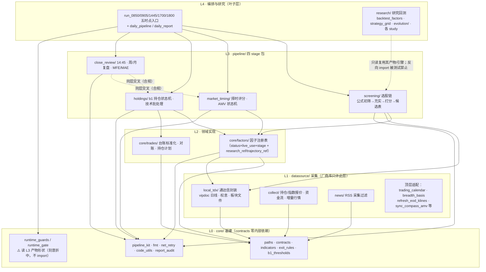

# AGENTS.md — Custos 协作共享认知

> 给所有在本仓库工作的 agent（含多机并行）的**最小必读**。只记两类东西：
> ① 不读代码就不知道、且**靠测试强制**的隐形纪律；② 快速定位的地图。
> 细节一律指向各目录 README/治理文档，本文件不复述（防漂移）。
> **改了本文件描述的行为时，必须同步更新本文件。**

## 0. 项目定位与核心原则

确定性脚本驱动的 A 股交易策略系统（择时/选股/持仓研判/卖出风控/总控决策/复盘）。

**核心原则：数据采集和因子计算全部由 Python 脚本完成，LLM 参与数据和消息分析、
市场信息判断、因子研究。** LLM 不进 live 交易决策与执行链路（live 零 LLM）。

核心思想：不追求胜率，追求盈亏比；杠杆加在出场与仓位管理（`README.md`、
`governance/strategy/_shared/system_principles.md`）。

## 1. 目录地图

| 路径 | 是什么 |
|---|---|
| `src/custos/core/` | L0 基建（paths/contracts/indicators/exit_rules）+ L2 因子/交易台账 |
| `src/custos/datasource/` | L1 数据采集（含 `local_tdx/` 本地通达信封装，文件解析器已下沉于此） |
| `src/custos/pipeline/` | L3 四个 stage 包 + L4 五时点 runner（run_0850/0905/1445/1700/1800） |
| `src/custos/research/` | L4 研究回测（只读管线数据，**生产永不 import 研究**，测试强制） |
| `src/custos/research/evolution/` | LLM 因子进化引擎（研究侧） |
| `governance/contracts` | 代码真读的 JSON 配置（EXIT_RULES 等）+ 工作流文档 |
| `governance/strategy` | 策略规则文档（一策略一目录 + STRATEGY_REGISTRY.json 强制登记） |
| `governance/research` | 研究单元 R1–R42（判据预注册，编号只增不复用；索引/纪律/工具目录见其 README） |
| `TODO.md` / `CHANGELOG.md` | 待办 vs 已改策略规则，两者分工严格（见 §4） |
| `tests/` | ~6600 测试，架构/契约/注册表/研究纪律全靠它强制 |

## 2. 架构分层（AST 测试强制：`tests/test_architecture_layers.py`）



因子包内部互赖（同层合法，注册表测试核对）：`b1_dual_factor → s_shape /
platform_pullback`、`main_rally_factor → rsi_state`、`sector_phase →
sector_mainstream`。

L0→L4 单向依赖，下层不得依赖上层；contracts.py **零内部依赖**（只许 stdlib）。
厂商库（mootdx/akshare/qlib/tqcenter…）只许 `datasource/` import（白名单钉测，
豁免集保持为空）。新增按日期命名的 JSON 产物必须在 `core/contracts.py` 建
schema 并在生产者落盘前 `require()`（豁免要登记理由），否则测试红。

两个语义注记（测试管不到、图上已标）：① `runtime_guards.py`（L0）读 L3 产物
形状——"守卫知道被守卫对象的 schema"是刻意折中；② L3 四包不是互相隔离的，
同层互 import 合法且已发生（见图注）。


## 3. 命令与环境

```bash
uv run python scripts/dev/test_affected.py   # 本地迭代默认：受影响模块 + 守卫集（--dry-run 看选择，--full 转全量）
uv run pytest -q                             # 全量（~6 分钟 / ~6600 例）；GitHub CI 双平台每个 push/PR 必跑
bash scripts/audit.sh                        # 六件套；第 0 件 ruff format --check 是唯一硬门槛
uv run --with mypy==2.4.0 mypy --config-file scripts/mypy.linux.ini src/   # 0 错基线；CI 有同名 job（ubuntu），版本与 audit.sh/ps1 三处互锚
```

- **测试分工**：本地提交前 `test_affected.py` 必须绿；全量交给 CI（ubuntu + windows），
  **CI 红必须当天修**（含 mypy job——0 错基线，任何新增 type error 即红）。conftest /
  pyproject / uv.lock / .github / tests/helpers_* 改动
  自动转全量；治理文件（governance/**、TODO/CHANGELOG/README/AGENTS、非数据 JSON）改动
  追加治理守卫集，并按「文件名出现在哪个测试里」补选。
- Python ≥3.11，依赖只有 pandas/mootdx/openpyxl/requests——**不得新增第三方依赖**
  （向量化用 numpy 等 pandas 自带物；DSL 解析用 stdlib ast，**禁止 eval/exec**）。
- 本机（dev）**无网络、无通达信数据**：测试一律合成数据注入（loader= / monkeypatch），
  conftest 已 block 部分网络、并把各台账改道 tmp。真实数据跑数只在生产机。

## 4. 治理纪律（全部有测试钉着，违反必红）

**TODO.md**：两张表——待办（每行：事项 / 优先级 P0~P3 / 卡在 owner·生产机·coder·观察中·挂起
/ 下一步 / 出处，单行 ≤400 字，不在行内打 ✅）、已闭环索引（只记去处）。完成的项
从待办删除**并在索引加一行**（编号 1..max 必须连续；仓库里任何「TODO #n」都要追得到）；
禁止 `~~删除线~~`；编号只增——**改前先 pull**（多机并行撞过号）。

**CHANGELOG.md**：每行 ≤400 字符；版本号只增不复用（撞号时后手顺延，已发生过两次）；
只记「已改的规则/行为」，不记待办。

**研究单元**（`governance/research/`）：判据跑数前写死、推翻标 🔄 不删、每条结论带
证据等级、判毕后头部/结论段同步、新单元带功效节与三栏结论模板、预注册修订留注记。
双窗 / pre2019 / **前向 holdout（≥2026-09-05 禁用）**/ 窗口使用台账的完整规则见
[`governance/research/README.md`](governance/research/README.md)「研究纪律」——
**写研究代码或研究单元前必读**。

**因子注册表**（`core/factors/`，`test_factor_registry.py`）：
- 元数据三维：status（证据）× live_use（允许怎么用）× stage（是否在跑）；
- 谱系字段 `research_ref`（R 文档须存在）/ `trajectory_ref`（`t_xxxxxxxxxx`）；
- `free_params≥4` 且 active ⇒ 必须有 research_ref；evidence_only 集合钉死；
- 规范入口 `detect(df, code, ctx=)` / `score()`，live 标注与研究 SCORERS 同源
  （改判定语义 = 语义变更，须立项 + 回测）。

**append-only 台账**（三本；写入只走各自唯一入口，每日首写前自动快照
`.bak_YYYYMMDD`，**严禁覆盖式写入**——2026-09-21 曾误用 write 工具覆写 0AMV 台账，
8215 行全历史灭失，靠备份救回）：

| 台账 | 唯一写入口 | 要点 |
|---|---|---|
| `data/market/0amv_observations.jsonl` | `amv_state.append_observation`（或 `>>` 追加） | 0AMV 全链方向主过滤器的历史 |
| `data/trades/plan_shadow_observations.jsonl` | `plan_shadow_ledger.append_shadow_safe` | 幂等 (date, code, stage)；写入点=review_core / final_close_review 重估流程（主批不传 plan）；default 计划视同无计划；**旁路隔离**：任何异常只 WARN，绝不打死主报告 |
| `governance/research/window_usage.jsonl` | `window_usage.record_use` | **入库**，只由生产机写入提交；注入件非 None ⇒ `synthetic=True` 不写（入口快照判定，生产方向有钉测） |

## 5. 研究层约定

研究侧的判据件、窗口规则、工具目录统一在
[`governance/research/README.md`](governance/research/README.md)，本节只列**写代码时
必须遵守的合入清单**：

- **新工具**：`research/xxx.py`（`add_argument` **全留本文件**，`_modes()` 用 AST 抽取）
  + `research/__main__.py` TOOLS 登记；入口 stdout/stderr reconfigure utf-8。
- **空结果护栏**：0 数据 / 0 结果 ⇒ 非零退出且不写产物。
- 研究产物 JSON **允许 NaN**（区别于生产侧 `paths.write_json`），落 `artifacts/logs/`，
  不建 contracts schema。
- **新研究终端合入清单**（缺一不合）：
  1. 判据结构用 `criteria_kit` 组装（四态、C4 池与状态、q95、簇打乱），不得自写一份；
  2. rdd 门用 `strategy_grid.rdd_gate_ok` 并传事先固定的参照档；C5 已退役（v0.356，
     终审=判定段 2017~2021 批量只读一次 + holdout，勿再引 `exit_c5_terminal`）；
  3. 窗口走 v2 段（`load_window.SEG_*` 常量），校验调 `load_window.segment_violation`；
     **挖掘窗**用 `load_window.mining_violation`（与判定段**相交即拒**，勿用
     segment_violation 代替）；段末隔离带用 `entry_deadline`/`clip_entries`；
     `--count` 用 `resolve_count`；逐股加载的终端调 `check_reach`；v2 模式 warm
     传 `warmup_bars=300`（段前预热只读价格，legacy 显式窗=0）；
  4. 读受保护判定窗（2017~2021）调 `window_usage.record_use`（键 `judgment_2017_2021`，
     旧键冻结拒写；读挖掘段不登记），判定口径用 `load_window.touches_judgment`
     （**相交制**——判定子窗也登记，勿用精确相等 == SEG_JUDGMENT），`synthetic`
     在函数**入口**快照；且须过 `judgment_batch` 批次门（--batch-id/--candidate-id +
     冻结配置哈希，候选不在批/已读/批已关一律拒；**过闸即写 claim 占位**——崩溃/中断
     也算已消耗，需重读开新批；哈希剔除 count——resolve_count 随日漂移；synthetic
     快照豁免）；
  5. 宇宙经 `universe.resolve`（缺省=规则构造全量个股，`--codes-file` 仅兼容通道）；
     报告接 `provenance.build`（宇宙三件套）与 `cost_sensitivity`；
  6. 带零假设校准两连测 + 回归哨兵（`tests/test_null_calibration.py`，collect_all 口径
     须含成簇用例）；带「生产路径写台账」钉测。
- **进化引擎**：LLM 只做提案，decision 由确定性函数给出；`--joint` / `--grid-judge`
  必须显式 `--count`；`--cell-top-n` 默认 20（=0 是因子轴退化）；非默认门口径
  （`--ic-gate` / `--gate-order`）须已在研究单元预注册。
- **因子 IC 画像**（`factor_ic_profile`）是分诊镜，不是晋级判据（晋级永远走双窗 + 三轴
  交易语义）。
- **指标盘缓存**（`research/indicator_cache.py`）：不得服务 live、不得服务 as-of 重播种
  路径；指标实现任何改动必须 bump `INDICATOR_PACK_VERSION`。

## 6. 多 agent / 多机协作纪律

1. **开工先 pull**；完成立即 commit + push（版本号顺增，批间可 revert）；
2. TODO / CHANGELOG 是单写者文件：改前 pull，编号冲突时后手避让顺增；
3. 改行为必同步：对应 README / 治理文档 / AGENTS.md 三处至少检视一遍；
4. 文档与代码不一致时**以代码为准**（schema / 注册表在代码里）；
5. 发现旧文档行动项已被推翻：在原出处就地标 🔄「已失效，勿照做」并写原因（代码写 docstring），不静默删除；
6. 生产机产生的台账（窗口使用台账等）跑完即提交，不要留在本地。

## 7. 快速定位

- 核心原则与架构：`README.md`；src 层细则：`src/custos/README.md`
- 研究索引 / 纪律 / 工具目录：`governance/research/README.md`
- 研究工具全量清单：`uv run python -m custos.research`
- 因子接口收敛设计：`governance/strategy/_factors/interface_unification_plan.md`
- 实盘教训台账：`TRADE_LESSONS.md`（只增不删）
