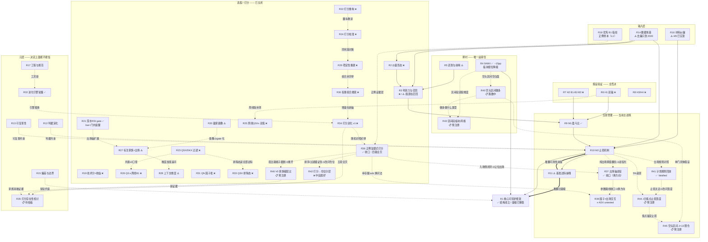

# B1 研究单元索引与主图

> 目的：沉淀 B1（J<13 反转买点）系统性回测的**结论、框架形态、偏差警示、工具用法**，
> 防止重复踩坑或误把有偏结果当实盘预期。**本目录全部是研究结论，不直接改动 live 逻辑**
> （回流 live 一律走 candidate→active + owner 拍板）。
>
> 2026-08-06 由单文件 `B1_BACKTEST_FINDINGS.md`（原文在 git 历史）拆成研究单元：
> 同一主题的结论散落各处且后面常推翻前面，按时间读会先读到已作废的数字。
>
> 阅读顺序：**当前状态** → 主图 → 总账 → 需要时进单元；写新单元前先读「研究纪律」。

## 当前状态（2026-10-13）

**一句话**：`0AMV 择时 + 反转K入场 + 带空间止损（≥5%）+ BBI 移动止盈 + 分散多槽`
是唯一可辩护的组合；**edge 来自择时 + 分散 + 交易管理，不是选股**。量级只在
0AMV 做多期成立（已实现 +0.454R/笔，做多期年化约 10%、回撤个位数，见 R1），且带
幸存者偏差（R14）。

**已关闭的路线**（不要重开，除非换问法并新立单元）：

- 选股 / 打分：R2、R3、R19、R22~R31、R33、R34、R36（四路全灭）、R42（仓位分层）；
- 出场参数搜索：R37（三战役收口）；
- 持仓计划规则（stop_loss_ref 当持仓止损）：R41（C2 判定窗 rdd 门不过 + C3 4/4 翻转）。

**进行中 / 待发令**：

| 单元 | 状态 | 下一步 |
|---|---|---|
| R40 空头区间做多 | r40_a1 已停、不作数（审计） | 按 v2 重跑修订在挖掘段重跑（#109） |
| R44 止损宽度 | 预注册，工具 ✅ | #92 后回填功效节 → 生产机挖掘段 8 档扫描 |
| R45 空头区间 J<13 × 30% 仓位 | 预注册，工具 ✅（`--r45`） | #91/#92 后回填功效节 → 挖掘内预演（A 选 B 验） |
| R43 区间段板块/风格 | 预注册 | #91 定段数后回填功效节；coder 实现工具（#93） |
| R39 因子×出场 | ADX 判毕 untested；v2 重测预注册 | 生产机挖掘内预演（A 选 B 验）过 C1~C4 才入第一批 |
| R46 V0 家族级配比 | 预注册定稿，工具 ✅（`family_lattice_study`） | #92 后回填功效节 → 挖掘段跑数（生产机） |
| R36 adx_gt_60 | v2 重测预注册 | 挖掘 B 前置核对 + 判定段冻结配置读数（#102 工具）|
| R35 打分存在性 | 开题 | owner 拍板终局（R42「中段最好」是新证据） |

**审计 2026-10-15**（代码已修 v0.382~0.387）：rdd 门亏损时方向反转、margin 含 open_end、组合层平分按代码号截断、q95 小池偏松等——受影响单元头部已就地标注，重算/重跑见 TODO #104~#109。

**长期限制**：2021 后无退市股（R14），近窗无法去幸存者偏差；判定窗已被反复读取，
其「样本外」资格在打折（见「研究纪律 · 窗口与数据」）。

## 主图：研究单元之间的关系



**读图要点**：粗箭头（`==>`）是**推翻关系**。R11 推翻了「无择时的纯出场组合有可用
margin」这个前提，R1 的量级随后按已实现口径重取（只在 0AMV 做多期成立）。

## 证据等级

| 等级 | 含义 |
|---|---|
| **L4** | 跨年 walk-forward + **含退市宇宙** + 净值对照；或口径错误这类可证明的事实 |
| **L3** | 跨 seed / 跨区间方向一致，但宇宙**带幸存者偏差** |
| **L2** | 单一区间或样本内多重比较，**未 OOS** |
| **L1** | 合成数据 / 单案例 / 仅逻辑推演 / 材料转述 |
| **L0** | 已实现但**未跑** |

⚠️ **L3 及以下的结论不得进入 live 逻辑。** 教训来自 R2：`reversal_quality_inv`
样本内大胜 +69.4%，含退市跨年验证翻转为 −11.9%。

## 总账

| 单元 | 主题 | 结论 | 等级 | 状态 |
|---|---|---|---|---|
| [R1](R1_core_framework.md) | 核心可辩护框架 | 0AMV + 反转K + 带空间止损 + BBI + 分散 | L3 | ⚠️ 结构成立、**量级待重估** |
| [R2](R2_selection_price_volume.md) | 价量形态与排序 | 随机/等权 ≥ 一切价量选择器 | L4 | ❌ 证伪（章节关闭）|
| [R3](R3_selection_discriminability_recall.md) | 判别力与召回 | 无跨窗共同点；**瓶颈在召回**（⚠️ 2026-08-13 受影响窗重算：「≥100% 带 −37.5%」作废、「单调下降」软化，瓶颈方向不变）| L4 | ❌ / ⚠️ 未研究 |
| [R4](R4_timing_amv_sector.md) | 0AMV + 板块相位 | 0AMV ~15pp（三熊窗重取）；板块方向不稳（降级）| L4 / 降级 | ✅ 0AMV 成立（2026-08-09 重取）|
| [R5](R5_timing_lateness_sentinel.md) | 迟到与前哨 | 无可机械化的提前量（0→53 天）| L3 | ⚠️ 可利用性未证 |
| [R6](R6_hypothesis_H1_dual_axis.md) | 假设 H1 双轴 | 未过跨窗终审 | L3 | ❌ 否决 |
| [R7](R7_hypothesis_H2_b1b2b3.md) | 假设 H2 B1-B2-B3 | 全否决（regime 过拟合）| L3 | ❌ 否决 |
| [R8](R8_hypothesis_H3_H4_pending.md) | 假设 H3/H4 | H3 ❌ gate 级三重门槛；H4 ❌ 公式自相矛盾（互斥零触发） | L0 | ❌ 否决（2026-08-11） |
| [R9](R9_method_M1_payoff_ratio.md) | M1 盈亏比 | 胜率不是该优化的变量 | L3/L2 | ✅ 方法论 / ⚠️ 落地待重验 |
| [R10](R10_mechanism_M2_stops.md) | M2 止损机制 | 收盘口径最大改进；5% 是崖 | L2 | 🔄 **前提被 R11 推翻** |
| [R11](R11_baseline_margin_collapse.md) | ⚠️ 基准崩塌 | **已实现口径 3000 样本为负** | L3 | ⚠️ 成立 |
| [R12](R12_meta_criteria_evolution.md) | 判据演化 | 6 类口径错误已修 | L4 | ✅ 已修 |
| [R13](R13_meta_reproducibility.md) | 可复现性 | 宇宙与窗口在漂移 | L4 | ⚠️ 开关默认关 |
| [R14](R14_meta_data_foundation.md) | 数据地基 | 前复权已对账；**去偏只到 2020** | L4 | ⚠️ 有硬限制 |
| [R15](R15_meta_bias_and_limits.md) | 偏差与边界 | 六类偏差 + PIT/市值特性 | L4 | ✅ 常驻 |
| [R16](R16_input_material_corrections.md) | 材料纠偏 | 8 条，4 已实现 | L1 | ⚠️ 待排优先级 |
| [R17](R17_infra_tooling.md) | 工程与规范 | 瓶颈是评估不是加载 | L4 | ✅ |
| [R18](R18_b1_fingerprint_evidence.md) | 优秀 B1 指纹（正例样本） | 合成标签召回 2/10；单项腿召回尚可；命中集中样本末端 | L1 | ✅（正例口径，边界明示） |
| [R19](R19_score_vs_return.md) | live 技术分×收益 | 不正相关（弱负，三臂出场对照一致）；强档低胜率高盈亏比 | L3 | ❌ 证伪（2026-08-21）|
| [R20](R20_winner_factor_enrichment.md) | 赢家单因子画像 | 大赢家=超卖更深（深水RSI 4.8~6.2 四臂全稳）；输家=看似走强（0.6~0.9 稳定反向）；12% 止损保留差异、5% 压没 | L3 | ⚠️ 画像成立，选股仍关闭（2026-08-23）|
| [R21](R21_rsi_deep_gate_validation.md) | 深水RSI 进场 gate 验证 | ✅ 跨窗通过：四档出场压基底（margin +26~+42pp，Wilson 不重叠）；12% 止损跨窗跳升最优；rsi_div 富集≠可交易 | L3 | ✅ 跨窗通过；📌 live 接线已落地（2026-09-14，v0.229）：owner 拍板=门内提醒（行动区 ⚡RD 仅提示），rsi_state→candidate，止损联动不启动 |
| [R22](R22_score_rebuild_variants.md) | 打分重构 V0-V3 | V2 证据重构翻正双窗（Spearman +0.09→+0.14）；篮子胜率 27%→47%/54%；V1 取反证伪；**pre2019 独立窗复核翻车**（半窗翻转 + 盈亏比破放宽线，edge 属近 regime） | L3 | ❌ 回收（2026-08-26，v0.123）：进 live 提案否决，live 维持 V0（TODO #66 已失效）|
| [R23](R23_qsx_resonance_filter.md) | QSX/DKX 两层过滤 | v1 双证伪；**v2：排除项（跌破未收复=空头有效）是全部边际**——砍 83% 交易后均收/期望R 转正（胜率 19.3%/盈亏比 4.78 极端互换），预注册线字面不过 | L3 | 🔄 v2 完成（2026-08-26）；排除态独立风控腿研究已立项 TODO #65（待排期）|
| [R24](R24_score_calibration.md) | 打分体系严谨重建 | Phase 1-2 查明结构（j_low 地板 + 4 正腿 + 6 负腿）且 P1/P2/P3 两窗全过；**Phase 3 pre2019 终审三候选 C1 全翻转 ⇒ 证伪**（与 R22 同死因：edge 属近 regime）；退回分位数分层 | L3 | ❌ 证伪（2026-08-28）|
| [R25](R25_weekly_qsx_resonance.md) | 周线 QSX>DKS ∧ 日周 J 双低 | ❌ 否决：③w 对② H20 仅 +0.7pp（判据 >3pp）且 H60 −1.6pp 显著变差；跨 seed 同向、跨区间 H20 42.3% 显著输无条件基准（与 R6 ③ 同死因）——周线多头结构过滤同样只删样本不选好票 | L3 | ❌ 否决（2026-09-03）|
| [R26](R26_qg_weekly_b1.md) | QG（共振v2）叠加周线 B1 | ❌ 否决：组合对母门槛 H20 −2.3pp/−2.6pp 两 seed 同向显著为负（判据要 +3pp）、H60 −4.5pp；召回 1.4% 触发样本不足条款；QG 单独臂计数无筛选力第三次复现 | L3 | ❌ 否决（2026-09-03）|
| [R27](R27_label_factors_exit_grid.md) | 标注因子家族 × 统一出场轴双窗对照 | RS 配 RD 优胜出场跨窗 +0.9pp 输基底 ⇒ 维持否决；RD 宇宙漂移下逐位级复现 R21（+42.7pp）；R★（新 gate）两窗 +33~+39pp 但低频记为线索；B2 交易层两窗 +19~+24pp 与 R7 信号层否决成口径张力（非平反）；异动后B1/突破回踩B1 无加值；主升始发点 0 触发 | L3 | ⚠️ 留证对照（2026-09-06）|
| [R28](R28_signal_context_dims.md) | 上下文维度（三面共振/空头前哨/技术高分）对 8 组标注信号的加值 | ✅ 唯一过线：RV×技术高分（两批两窗同向 +7.7~+21.8pp）；RS×共振判为做多腿混入的假阳性；空头前哨假设证伪（8 信号无一两窗同向）；RD/R★ 与「优∧强」互斥不适用 | L3 | ⚠️ 留证对照，RV 升级需扩窗复核（2026-09-06）|
| [R29](R29_score_stability_rebuild.md) | 胜率稳定≥40% + 盈亏比≥2.4 打分重建 | ❌ 证伪（死在窗内，未进终审）：W1/W2/W4 主窗+跨窗 C1~C4 全过（胜率 43.6~53.7%/盈亏比 2.42~2.91）但 ±50% 灵敏度翻转 1~3 次（参数敏感）；W3 参数稳但主窗盈亏比 2.14 失 C2；推荐名单为空 ⇒ Phase 3 未启动，pre2019 保持 untouched；打分重建三轮六候选无一幸存 | L3 | ❌ 证伪（2026-09-07，Phase 2）|
| [R30](R30_score_combo_search.md) | 打分权重有界组合搜索 | ❌ 证伪（结局②）：5702 组合 532 过加严线、灵敏度后 305 存活，top 3（rsi_deep 30-40+wj_low 20-30+macd底背离 10+leader_vol 20-30+负腿块）pre2019 终审 F2 全灭——盈亏比 2.076<2.4（胜率 41.3% 守线、Spearman 半窗同正）；打分权重路线四轮十候选无一幸存，收口 | L3− | ❌ 证伪（2026-09-08，终审）|
| [R31](R31_qn_factor_validation.md) | QN 因子批（骑牛登山体系 12 gate）入场加值验证 | ❌ 跑数判负：12 gate 全灭——9 否决（C2 加值未双窗过线：ma25/三线红/ma144/买小绿/箱体/收拢/阳包阴双窗同向不足，倍量切一正一负、J 负值主窗贴线；转 needs_work 引本页）+ 3 样本不足（adx 双窗 <100 笔/缩量板成交 2+0 笔/weekly180 结构性 0 评估）；无线索不开第二轮；口径披露：H20 映射为交易模拟胜率读数 | L3− | ❌ 判负（2026-09-08，双窗 s3000）；⚠️ 否决对应**校准前语义**——qn_kdj_neg_day/qn_ma_converge 经 v0.200 案例校准已改，盈利判定以复跑为准 |
| [R32](R32_evolution_engine_smoke.md) | LLM 进化引擎真实数据冒烟 + 三轮修复验证 + 随机 baseline 裁决 | ✅ 全部闭环：链路三通（DSL 门 24/24）；#69/#70/#75 修复均生产机复测——r4 同 gate/出场两格 objective 分化（scorer 轴恢复）、慢格 18s/格且修复前后逐位一致；#71 裁决：随机过门 17% ≪ LLM 67%/100%（Fisher p=0.057）⇒ LLM 假设生成有增量（初步）；副产：纯 Amihud 选中子集最优（收益/回撤 5.73，R11 caveat）；VWAP 候选三轴 best cell 0.7395（线索留证） | L4 / L3− | ✅ 闭环（2026-09-12）/ 候选晋级走注册表流程 + 增量腿检验 |
| [R33](R33_qsx_exclusion_portable_filter.md) | 「跌破 QSX/DKX 未收复=排除」独立成可移植回避条件的边际验证 | ❌ **否决收口**（2026-09-16，kill-switch 第 0 步终止）：Cp 臂 ±排除态差值法（BBI 族口径，2010 起 s3000 终审）——排除项边际全指标为负：胜率 24.4% vs 36.8%（−12.4pp，Wilson 不重叠）、均收 −0.48pp、期望R −0.040；400 冒烟同号（−12.3pp）⇒ ≤0 实锤，按手册直接结局②，gate 工程与四步双窗免跑；「可移植风控腿」建议回收：排除态只在共振命中票内、负基线出场族下成立（与 R23 v2 BBI 先验互洽——正基线下它砍掉的是好交易） | L3− | ❌ 否决（2026-09-16 kill-switch 签发）|
| [R34](R34_score_system_evolution.md) | 打分系统进化 v1：新轴基因组（腿集合×权重格） | 双来源 top 均打不过随机臂（C4），判定窗再衰减。C4 臂后被勘误为非干净零假设（v0.266，证据等级下调）；干净池 q95 +0.0058 仍高于两 top（−0.0007/−0.0039），证伪维持 | L3− | ❌ 证伪（2026-09-15）|
| [R35](R35_score_system_existence_review.md) | 打分系统存在性检讨（元层） | 五轮证伪总账 + 三终局候选（A 维持 V0 粗过滤 / B 只留有独立证据的腿 / C 撤分改门）；R36 Phase 1 与 R42 是之后新增的证据 | L4 | 📋 开题，待 owner 拍板 |
| [R36](R36_perfect_b1_supervised_scoring.md) | 完美 B1 正例监督式打分 | 入场侧四路（挖掘/加腿/调权/过滤器）全灭；唯一幸存单腿 adx_gt_60 的 C4 死刑经复核撤销，C5 pre2019 untested（CI 跨 0） | L1 样本 / L3− | ✅ 收口判毕（2026-10-05）|
| [R37](R37_exit_axis_evolution_campaign.md) | 出场轴进化战役（出场基因组 × 战役壳） | 三战役 1 untested（r37_b1，存档不接 live）+ 2 证伪；C5 首判 killed 系加载截断事故，复跑 untested（按 v0.298 新规则会判 killed，owner 拍板不翻案）；b2/b3 跑在 objective v1 下 | L2 / L3− | ✅ 收口签发（2026-10-08，换方向 → R39）|
| [R39](R39_factor_exit_interaction.md) | 因子×出场交互（因子能否告诉我该用哪套出场） | 首对象 ADX(14)：top 退化为 uniform-best 自身，72 个非退化映射无一双窗胜出 ⇒ 无条件化增量证据；机械判决 untested（C1 桶薄） | L2 / L3− | ⏸ r39_a2 判毕 untested（2026-10-09）；下一对象待 owner |
| [R40](R40_bear_regime_long_strategy.md) | 0AMV 空头区间做多全栈（46 门 × 5 档） | 基准=随机入场臂（预算对等 max-of-230、冻结配置读判定窗）；四条风险注记写死，绝对读数不进 live | L2 / L3− | 📋 Phase 1 ✅；r40_a1 改门后重发车（2026-10-09），待回填 |
| [R41](R41_position_plan_rules_replay.md) | 持仓计划规则离线回放（stop_loss_ref 止损 vs 现行 EXIT_RULES） | #60 并轨「规则好不好」那一半；两版止盈相同，Δ 只来自止损；现行版主读数 pct10 | L2 / L3− | ❌ 判毕 falsified（2026-10-13，r41_probe）：C2 判定窗 rdd 门不过 + C3 4/4 翻转 |
| [R42](R42_score_tier_position.md) | 打分→仓位分层（V0 三档单调性 + 仓位增量） | C2 单调性双窗倒挂：中段最好、高档不是最好（挖掘窗倒挂约 4~6×MDE 可分辨，判定窗约 1.3~1.9× 作旁证）；打分→仓位分层路线死刑 | L3− | ❌ 证伪（2026-10-10，r42_probe）|
| [R43](R43_regime_sector_style.md) | 0AMV 区间段的板块与股票风格（空头抗跌 / 多头进攻） | 38 个风格维度 + 880/881 板块指数，按区间段五分位价差；C4=伪区间段 max-of-K 零假设 | L2 | 📋 预注册（2026-10-14），工具待实现 |
| [R44](R44_low_anchor_stop_width.md) | J 日最低价锚定的止损宽度寻优（0AMV 做多） | 止损 = 信号日最低价 × (1−x)，x ∈ 5%~20% 8 档 vs 现行 pct10；收益率口径 margin + rdd 门、双挖掘段选档一致 + 邻档平滑、C4 随机宽度 max-of-8 | L2 | 📋 预注册（2026-10-15），工具 ✅（v0.379） |
| [R45](R45_bear_jlow_capped_exit_grid.md) | 0AMV 空头区间 J<13 单门 × 总敞口 ≤30% × 4×4 出场网格 | 两个基准都要打过：不交易（现行防守）与同上限随机入场（max-of-16）；双挖掘段选格，判定段攒批 | L2 | 📋 预注册（2026-10-15），工具 ✅（v0.397 `bear_regime_study --r45`）|
| [R46](R46_v0_family_weight_lattice.md) | V0 打分家族级配比（R36 Phase 3 配比路重开） | 30 腿分 6 家族 × 倍率 {0,1,2} 全枚举 729 格；零假设=簇级置换打分↔收益同预算 max-of-729；双挖掘段选格、邻格平滑 | L2 | 📋 预注册定稿（2026-10-16，v0.404），工具 ✅ |

## 研究纪律

### 写入规范

- 一个单元 = 一个**研究问题**。新结论追加到该单元的「证据与过程」，并**同步更新头部
  「状态」与「结论」段**——判毕后头部/结论段不得再写「待跑数/待发令」（测试强制）。
- 结论被推翻时**不删除旧结论**，标 🔄 并写清被什么推翻（见 R10）。
- 每条结论带**证据等级**；拿不出等级的，说明它还是猜测。
- 编号只增不复用（R38 已被 live-only 出场回测化预留）。
- 结论段用三栏模板（v0.321 起新单元强制）：**机械判决 / 实质读数 / 不能读成什么**。
- 判据**跑数前写死**；跑数前的修订要在文档里留「修订」注记——产物记录预注册文档的
  blob hash，`test_prereg_revision_notes.py` 机械核对。
- 新单元的预注册必带「**功效**」节：用 `power_mde` 估 MDE，MDE 大于合理效应就在跑数前
  合并桶或改问法。配对比较用 `rho_pair`；组间（不配对）比较 `rho_pair=0`；同日成簇用
  `deff`。两者方向相反，不要混用。
- **三维度搭配**（owner 2026-08-21）：策略类研究以 **因子 × 止损 × 止盈** 为实验单元，
  不单跑「只换因子」或「只换出场」下结论（R10：`cost_zone` 在 A 组 ❌、在择时上下文最优）。
- **默认研究基底**（v0.93）：0AMV 做多区间 + J<13 钉死、不作扫描变量；扫描的是叠加
  其上的 gate/scorer 与出场参数（`--no-amv-pin` 仅对照用）。

### 窗口与数据

- **窗口布局**（owner 2026-10-13 拍板，**v0.356~v0.358 已落地**）：
  | 段 | 范围 | 用途 |
  |---|---|---|
  | 挖掘 A | 2000-01-01 ~ 2016-12-31 | 挖掘（原 pre2019 并入） |
  | 判定 | 2017-01-01 ~ 2021-12-31 | 终审：攒一批候选只读一次，单独记台账 |
  | 挖掘 B | 2022-01-01 ~ 2026-09-04 | 挖掘（原挖掘窗 + 已读脏的原判定窗） |
  | 前向 holdout | ≥ 2026-09-05 | 最后一道关，冻结不变 |

  - 段边界设**禁开仓隔离带**（段末单侧 90 自然日 ≈ 最长持有期，owner 拍板；单源
    `load_window.entry_deadline` / `clip_entries`）。作用=**防 open_end 强制平仓偏差**
    （owner review #4 更正）：数据本身已截到段末，持仓本就不可能读到下一段、不存在泄露；
    段末开仓的交易会在段末 bar 被强制按 open_end 平仓，R11 已证明 open_end 系统性偏正——
    段末 90 天不开仓即减少这批偏差交易。指标预热只读价格，不算读判定段。
    随机臂母体同纪律（bear `_seg_bar_pool_clipped`）。
  - 窗口校验单源 `load_window.segment_violation`（须 ⊆ 某段、越段/触 holdout 硬拒绝；
    段内子窗合法——R40 旧窗 ⊆ 挖掘 B 的 legacy 兼容通道）；双窗规则=**不相交**
    （任一序皆可，旧「mining 必在 judgment 之前」退役）。
  - **C5（pre2019 终审）取消**，由判定段 + holdout 接替；已判 C5 结论（R36/R37）保留不改。
  - 切换后第一步是**基线重测**（R1/R4/R11 量级），**只在两段挖掘上做**；判定段基线留到第一批候选判定时同次读出。
  - 2000~2009 先核数据（TODO #91）：0AMV 台账能否回溯（不能则挖掘 A 从有数据日起）、板块覆盖稀（2011-10 前 198/587）。生产机跑
    `uv run python -m custos.research data_coverage_probe --tdx-root <通达信根> --out artifacts/logs/data_coverage_probe.json`，
    JSON 贴回本节。基线重测的命令与读数口径见本节末「基线重测 runbook」。

- 🔄 **旧双窗（v2 前制度，R40 及此前单元按其跑数；勿用于新单元）**：挖掘窗
  2022-01-01~2024-07-31 / 判定窗 2024-08-01~2026-09-04（s3000 钉死宇宙）；寻优全程不读
  判定窗、mining.end < judgment.start。🔄 **pre2019 终审段**（2010-2016）：曾只用于 C5，
  已随 C5 退役并入挖掘 A。
- **前向 holdout**（v0.321）：≥2026-09-05 的数据任何研究不得使用，攒作下一轮判定窗。
  单一来源 `load_window.forward_holdout_violation`，所有接受窗口参数的入口都调用；
  末段交易出场落入 holdout 只做注记（`EXIT_BARS_HOLDOUT_NOTE`），不截数据。
- **窗口使用台账** `window_usage.jsonl`：每次读**受保护判定窗**记一行，报告写「第 k 次」。
  v2 键 = `judgment_2017_2021`；旧键 `judgment`/`pre2019` 冻结拒写（只判读历史行）；
  读挖掘段（含旧判定窗区间）不入台账。台账**入库**、只由生产机写入并提交；
  合成运行（任何注入件非 None）不写。台账自 2026-10 起计，此前约 13 个单元已读过
  旧判定窗，**k 只是下限**。
- `--count` 缺省自动推算（`load_window.resolve_count`），`check_reach` 实测兜底。
- **研究宇宙**（owner 2026-10-13 拍板，**v0.356 已落地**，单源 `research/universe.py`；
  R40 及此前单元沿用 s3000，读数不跨口径对比）：
  沪深京 A 股**个股**（不含指数/ETF/债券/B 股，判定与 live 同源 `code_utils.is_ashare_stock`）；
  **不冻结名单**（缺省=vipdoc 全量枚举，`--codes-file` 为显式钉死兼容通道），按**信号日 as-of**
  定资格（该日已满 60 根 K 线即可出信号，与 live `min_list_days: 60` 同源）；**不过滤 ST**
  （live 按当前名称排除 ST，没有历史 ST 状态，as-of 复现不了——与 live 的已知差异）；
  不设版本号，provenance 记宇宙规则 + `n_codes` + `universe_sha256`（解析后名单指纹），
  跨运行累积的台账/轨迹池宇宙不一致即拒绝续跑。vipdoc 无退市股，幸存者偏差不变（R14）。

#### 判定段攒批协议（owner 2026-10-14 拍板；批次锁实现见 TODO #95）

- **一批只读一次**：候选在挖掘段跑完、配置冻结（哈希）并预注册后入批；同批一次读出判定段
  2017~2021，读后关批。同一候选不得二次读，批外不得零散补读（批次锁硬拒绝）。
- **判定线的池（v0.389，owner 2026-10-15 选 B，跑数前修订）**：每个候选的随机臂在挖掘段选型冻结后，在**入批读数的同一次运行**里把冻结配置拿到判定段重读一次（不重选），池元素 = 臂判定段 Δ；候选判定段 Δ 与该池比（`judgment_batch.judgment_line`，m 从名册读）。**不得**拿挖掘窗 C4 池比判定段读数（窗口不同、零假设不同）；臂池不得事先单独跑（等于提前读判定段）。
- **多重比较**：每个候选沿用自身 C4 随机池，判定线由 q95 收紧到 **q(1−0.05/m)**（m=本批候选数，
  m=4 ⇒ q98.75）；分位越高需要越多过门臂，预注册时按 m 估随机臂预算（m=4 约 ≥200）。
- **第一批**：截止日 = #92 基线重测完成 + 4 周，届时已冻结的候选入批，其余进第二批。拟入批：
  R36 adx_gt_60 单腿、R39 ADX 全量宇宙重测、R44 冻结档 x*（#97 已并入）、R43 在挖掘段
  过 C1~C4 的维度；R45 工具赶得上则入。r37_b1 **不陪跑**（v1 口径候选，占 m 名额会拉高全批判定线）。
- **前向 holdout 解冻**：功效节通过（holdout 实际样本量下 MDE < 预注册效应），**或**攒满 24 个月
  （到期样本不足照开，结论最高 provisional）；一次性使用，解冻日起重新攒下一轮；由 owner 发令，
  工具不自动解冻。

**批次锁用法**（v0.374 落地，`judgment_batch` 模块；登记文件 `judgment_batches.jsonl` 入库、
append-only、生产机写入提交）：

1. **冻结**：打算跑数的那条命令加 `--print-config-hash` → 打印 `<tool>:<hash>`（不碰数据）；
2. **开批**：`uv run python -m custos.research judgment_batch open --batch-id b1 \
   --candidate r36_adx_gt_60:<hash>:R36:备注 [--candidate ...]`（批次号只增不复用，空名册拒）；
3. **跑数**：原命令加 `--batch-id b1 --candidate-id <id>`——候选不在批/哈希不匹配/已读/批已关
   一律 exit 2；**过闸即写 claim 占位**（v0.375 #99②：宁可错杀，崩溃/中断也算已消耗，
   需重读由 owner 手动开新批），跑完补 read；合成运行（注入件）与判定窗不接触
   （legacy 窗）不查批。配置哈希剔除 count（v0.375 #99①：resolve_count 自动推算随日
   漂移，count 只影响起点可达性，check_reach 兜底）；
4. **关批**：末位候选读完自动关；手动 `judgment_batch close --batch-id b1`；
   `status [--batch-id]` 查批状态/已读/未读清单。

**生产机逐步执行版**：[`batch1_runbook.md`](batch1_runbook.md)（#91 → #92 → 挖掘段 → 冻结 → 开批 → 读数，命令逐字可复制）。

**冻结与开批流程**（第一批起执行；每个候选一行登记，缺项不得入批）：

| 步骤 | 做什么 | 留档 |
|---|---|---|
| 1 挖掘段过线 | 只读挖掘段（扫描模式 / 挖掘内预演 / 前置核对）跑完，C1~C4 机械判决 = candidate | 研究单元回填区写读数与产物路径 |
| 2 冻结命令 | 把**读判定段那条命令**逐字写进研究单元，末尾加 `--print-config-hash` 跑一次 | 命令原文 + `<tool>:<hash>` 写进回填区 |
| 3 截止日 | 截止日当天，owner 按已冻结名单发令开批：`judgment_batch open --batch-id bN --candidate <id>:<hash>:<Rxx>:<备注> ...` | `judgment_batches.jsonl` 提交入库 |
| 4 读数 | 同一命令去掉 `--print-config-hash`，加 `--batch-id bN --candidate-id <id>` | 产物 + 回填；台账 `window_usage` 自动登记 |
| 5 判决 | 判定线 = 候选自身零假设池 q(1−0.05/m)，m = 名册人数 | 研究单元结论段三栏 |

- 进哈希的参数（窗口、种子、宇宙规则、判据参数……）冻结后一个都不能改；不进哈希的只有不影响读数的簿记项：
  count（随日变）、`--tag`、`--out-dir`、`--jobs`（v0.406 起；崩溃重跑可换 tag/目录）。`--timeout` 进哈希（格子超时会改变读数）。
- 名册定了就不增不减：m 按开批时的名册算，读数中途死掉的候选也计入 m（claim 已写）。
- 判定线判决件与「冻结配置读判定段」模式见 TODO #102，**#102 落地前不开批**。

#### 基线重测 runbook（TODO #92，v2 口径）

命令**写死**，改动须先改这里再跑。公共参数（宇宙缺省=全量 as-of，不传任何 codes 旗标）：
`--scorer baseline --entry-filter j_low --stop-mode pct --stop-pct 8 --bbi-consec 2 --cost-bps 25 --trade-sim --seed 0`。

- **步骤 0（先跑 #91 探针，再定 R4 挖掘 A 起点）**：`--amv-long-only` 的
  `_amv_checker` 对**台账首日之前的日期一律拦截**（as-of 查不到 regime ⇒ 不放行）
  ——AMV 腿实际覆盖从台账首日起，无 AMV 腿却是全段；四格起点不齐会把不同年份的
  行情差异混进「择时增益」。因此从探针 JSON 读 `amv_ledger.date_min`，记
  **SEG_A_START = max(2000-01-01, 台账首日）**，R4 挖掘 A **四格统一**用此起点，
  count 用 `load_window --start SEG_A_START` 重算。R11 无择时腿、无此混杂，
  维持 2000-01-01 全段（要与 R4 同窗对齐可另跑，不默认）。
- **R11 基准**（无择时纯出场组合，已实现口径）×2 段：
  ```bash
  uv run python -m custos.research backtest_factors --trade-sim \
    --scorer baseline --entry-filter j_low --stop-mode pct --stop-pct 8 \
    --bbi-consec 2 --cost-bps 25 --seed 0 \
    --start 2000-01-01 --end 2016-12-31 --count 7200 \
    --summary-only --out artifacts/logs/baseline_v2/r11_segA.json
  uv run python -m custos.research backtest_factors --trade-sim \
    --scorer baseline --entry-filter j_low --stop-mode pct --stop-pct 8 \
    --bbi-consec 2 --cost-bps 25 --seed 0 \
    --start 2022-01-01 --end 2026-09-04 --count 1600 \
    --summary-only --out artifacts/logs/baseline_v2/r11_segB.json
  ```
  读数口径：trades 汇总块 `trade_summary.n` / `trade_summary.win_rate` /
  `trade_summary.expectancy` / `trade_summary.expectancy_R`。**剔除 open_end**：
  bt 裸跑没有段末隔离带（那是四终端的 `clip_entries` 纪律），段末交易会按
  open_end 强平在段末 bar（R11 已证偏正）——用 `trade_summary.exit_reasons.open_end`
  的 n/avg_return 从全量期望剔除（n_r·E_r = n·E − n_oe·E_oe 后除以 n−n_oe），
  或重跑不带 `--summary-only` 逐笔过滤 `reason` 以 open_end 开头
  （同 `score_return_study.py` 口径）；win_rate 按全量报并注明含 open_end。
- **R4 择时网格** 2×2×2 = 8 条：公共参数上叠 `--portfolio --risk-pct 1 --max-concurrent 5 --max-pos 20`；
  AMV 腿加 `--amv-long-only`，板块腿加 `--sector-filter`（依赖 `data/market/sector_index/`
  + `sector_members.json`，生产机已有）；挖掘 A 起点=SEG_A_START（步骤 0），挖掘 B
  窗同 R11；产物 `artifacts/logs/baseline_v2/r4_seg{A,B}_{amv,sector,amv_sector,none}.json`。
  读数口径：portfolio 块 `portfolio.cagr` / `portfolio.max_drawdown` /
  `portfolio.total_return` / `portfolio.return_over_maxdd`（收益/回撤比，
  注意键名不是 ret_dd）+ trades 层 `trade_summary.expectancy_R`（open_end 口径同上）。
  **板块腿缺数据语义**（代码事实，读数按此解读）：成员表或板块指数目录整体缺失
  ⇒ fail-closed 拒跑（不静默全放行）；个股未分类到「有数据板块」⇒ **放行**；
  已分类到有数据板块、日期早于板块数据起点 ⇒ **拦截**（gate 带 `effective_start`=
  最早板块数据日，--start 早于它时 bt 打 [WARN]）。⇒ 覆盖稀疏期（2011-10 前仅
  198/587）板块腿只是**部分过滤**，两腿差值被稀释——故挖掘 A 加跑 **2012 起子窗**
  完整 2×2（4 条：`--start 2012-01-01 --end 2016-12-31 --count 4200`；若 SEG_A_START
  晚于 2012-01-01，子窗起点=SEG_A_START 并重算 count），产物
  `r4_segA2012_{none,amv,sector,amv_sector}.json`；对比必须同窗 ⇒ 不能只跑板块两格。
- **R1 量级不单跑**：取自 R4 网格「有 AMV 无板块」两格
  （`r4_segA_amv.json` / `r4_segB_amv.json` 的 `trade_summary.expectancy_R`
  + `portfolio.cagr` / `portfolio.max_drawdown`）。
- 注记：`--count` = 从最新 bar 回溯根数，宁多勿少——多出的部分被 `--start` 裁掉、
  指标在裁剪后冷启动，故 count **只影响起点可达性、不影响读数**（busday
  (起点→今天)：2000 起 ≈7000、2012 起 ≈3900、2022 起 ≈1250，命令各留了余量）。
  起点变动时用 `uv run python -m custos.research load_window --start YYYY-MM-DD`
  重算。引擎 CLI 无 `--warmup-bars`，段起点指标冷启动与 R1/R4/R11 原口径一致
  （可比性优先）；判定段基线留到首批候选判定时同次读出。
- **耗时收集**（v0.364 埋点）：每条命令把 stderr 的 `[TIME]` 行
  （`加载(含前复权)…/ 评估…` 与 `总耗时…`）与产物 JSON 的 `timing` 块
  （load_s/eval_s/total_s）贴回本节；四终端 warm 耗时由 `[TIME] warm …` 行提供。

### 判据件（单一来源；新终端必须复用，禁止再抄一份）

| 件 | 位置 | 要点 |
|---|---|---|
| 四态结局 | `criteria_kit.verdict_four_state` | C1 不过 ⇒ **untested** 优先；C2/C3 为 None ⇒ provisional；falsified 只来自 C2/C3 False 或 C4 confirmed_fail |
| C4 池与状态 | `criteria_kit.assemble_c4_pool` / `c4_state_of` / `q95` / `batch_threshold` | 判定线 = 置换检验次序统计量（第 ⌊α(n+1)⌋ 大，v0.385；批次 α=0.05/m）；N 指**过门臂数**，重抽至满或 10×N；空池 indeterminate（不放行）；池未满 provisional；随机臂与候选**同预算**（同样的挑选次数） |
| 簇打乱 | `criteria_kit.cluster_ids` / `cluster_draw` | collect_all 口径交易成簇（同票相邻 ≤5 bar），C4 打乱/赋桶按**整簇**，不按笔 |
| 搜索标量 | `strategy_grid.search_objective` | objective **v2.1**：margin 单量（**已实现交易**，v0.383）+ rdd **相对门**（候选 ≥ 事先固定的参照档；rdd 符号感知——收益<0 用 收益×回撤，v0.382）；参照缺失 fail-closed；v1/v2 读数不跨版本引用，续跑跨版本被拒 |
| C5 终审 | 🔄 已退役（v0.356）：pre2019 终审由判定段 2017~2021 + holdout 接替；`exit_c5_terminal`/`score_c5_terminal` 标 stale（可复现 R36/R37，勿用于新判决） | 已判结论不改 |
| 溯源 | `provenance.build` | git sha+dirty / 判据版本 / 预注册 blob hash / **宇宙规则+n_codes+名单 sha256** / 数据末日 / 命令行 |
| 成本副读数 | `cost_sensitivity` | 25/50bps 双报，翻号标「成本敏感」 |

**合入门**（`tests/test_null_calibration.py`）：新终端必须带纯噪声校准（confirmed_pass
≤ ~10%）+ 植入真 edge 可识别；噪声逐笔 iid 有方差、池 ≥20、含成簇用例，并配**回归
哨兵**（换回已知 bug 构造时校准必须失败）。

## 研究工具目录

**按 0AMV 区间看入场 / 止损 / 止盈 / 仓位的现行规则与研究状态**：[`strategy/b1/90_regime_overview.md`](../strategy/b1/90_regime_overview.md)（判毕或 live 改规则时同步更新）。


全量清单：`uv run python -m custos.research`（按 引擎/驱动/研究/诊断 分组，含模式开关）。
当前一代终端：

| 工具 | 单元 | 作用 |
|---|---|---|
| `strategy_grid` | 通用 | 因子×出场联合寻优网格；出场 schema 与 live `EXIT_RULES.json` 一致，CLI 第一名可回流 |
| `evolution_loop` | R32 | LLM 因子进化（LLM 只提案，decision 确定性）；`--joint` / `--grid-judge` |
| `score_evolution_study` | R34 / R36 | 打分基因组裁决；`--v0-lattice` 调权格 / `--addon-leg` 骨架加腿 |
| `score_filter_study` | R36 P4 | 排序器→过滤器判据 |
| `exit_campaign` | R37 | 出场基因组战役壳（CTL-1~5；台账续跑带 objective 版本守卫） |
| `exit_c5_terminal` / `score_c5_terminal` | R37 / R36 | 🔄 已退役（v0.356，勿用于新判决——pre2019 终审由判定段 2017~2021 + holdout 接替，与判据件表对齐；保留只为复现 R36/R37） |
| `factor_exit_study` | R39 | 因子分桶→出场档 80 格枚举，主基准 uniform-best |
| `bear_regime_study` | R40 | 空头区间 46 门×5 档，随机入场臂基准 |
| `plan_rules_replay` | R41 / R44 | 计划止损 vs 现行出场配对回放（引擎信号级 `stop_override` 钩子）；R44 扩展：`--stop-anchor signal_low` 锚点 + `--scan-widths` 挖掘段 8 档宽度扫描（不读判定段） |
| `score_tier_position_study` | R42 | V0 分档单调性与加权 expectancy_R |
| `regime_style_study` | R43 | 0AMV 区间段风格/板块描述性条件化（41 维 as-of 价差 + 伪段 C4；不接交易引擎） |
| `plan_shadow_review` | #60 | live 影子台账分歧段事后打分（N=5/10） |
| `factor_ic_profile` | 分诊 | 截面 RankIC/ICIR 可比表——**分诊镜，不是晋级判据** |
| `data_coverage_probe` | #91 | 数据覆盖探针：vipdoc 个股/板块指数 + 0AMV 台账 + sector_index csv 覆盖普查（定挖掘 A 起点） |
| `power_mde` / `load_window` / `window_usage` / `criteria_kit` / `provenance` / `cost_sensitivity` | 基础件 | 见上「研究纪律」 |

**LLM 进化引擎口径**：LLM 只做假设生成/变异/杂交与解读；live 链路零 LLM；候选晋级 live
须判定窗终审 + 因子注册表 status 流程 + owner 拍板。演进与冒烟记录见 R32。

---

# 历史档案

以下各节是 2026-08 的排查与拆分留痕，**结论已并入上方各单元与总账**，保留供引用溯源。

## 旧「一句话结论」（2026-08；量级已于 08-09 按 R1 重取）

**结构上**：`0AMV择时 + 反转K入场 + 带空间止损（≥5%，别更紧）+ BBI移动止盈 + 分散多槽`
是目前唯一可辩护的组合；**edge 来自择时 + 分散 + 交易管理，不是选股**
（R19 补充：live 技术分对信号后涨幅亦无预测力，三臂出场对照一致）。

**量级上**：⚠️ **不知道。** 3000 样本下已实现口径为负期望（R11），
而这个数字**还带幸存者偏差**（R14：2021 后无退市数据）。
在 R11 的问题解决前，任何 CAGR/期望数字都不应被引用。

## 旧「下一轮入口」（2026-08，已被上方「当前状态」取代）

1. **R11 的问题先解决** —— 换个提法：不问「能提升多少」，而问
   「有没有方案能在 3000 只宇宙里做出 >3pp margin」。跨组表前三名的 amv 系是唯一候选。
2. **R3 的召回瓶颈** —— 拆「大牛股在起涨前长什么样、被哪一条门槛挡掉」
   （反向排查 j_low/缩量/振幅各条件的召回损失），而**不是**再造排序特征。
3. **R14 的去偏能力** -- 需要退市股历史行情源才能覆盖 2021 后窗口。

### 从原 §5 承接的收尾项

- **【已完成】「空头段识别未来赢家」12 窗研究（2026-07-31）**：结论**证伪**，无跨窗共同点（见 R3）。
  原两个收尾项：① `--survivorship-report` 看「零收益中已摘牌」列，确认 `--exclude-zero-ret`
  有没有删掉真飞刀 —— **已失效，永远无法再跑**：它依赖 qlib 的含退市股宇宙，qlib 接口已于
  2026-08-24（v0.109）整体删除且无 tdx 等价物，`--survivorship-report` 随删；
  ② `--zero-ret-report` 按 volume 查明 2022 年后僵尸样本成因 —— 仍可在本地 vipdoc/tdx
  宇宙上跑（纯读 firings + 按需重载，不重跑 Pass1），但宇宙不含退市票。
- **【已完成】跨年份真样本外验证（2026-07-28）**：7 窗口 walk-forward（含退市股宇宙）
  结论**选丑反转证伪**（见 R2）。后续若再做选股研究，跨年份窗口仍为准入门槛，
  **样本内 train/test 不再接受为证据**；含退市宇宙这条已失效——`--universe-sdata`
  随 qlib 接口于 2026-08-24（v0.109）整体删除，现行宇宙口径是 `--universe-local`
  （本地 vipdoc/tdx；2021 后无退市股、无法去偏，见下「三个根因」）。
- **全市场 OOM**：流式 + cap + summary-only 已缓解；`--top-n`(collect_all) 大样本仍重，
  彻底解需「只模拟被选中交易」或向量化（见 R17）。
- **归因**：可加「交易收益对基准回归求 alpha/beta」，判断收益是 alpha 还是小盘/牛市 beta。

## 跨窗终审总账（2026-08-03）

本轮（H1 双轴/共振/QSX 周线、H2 B2/底部异动全部口径）**无一通过跨窗终审**，
死法相同：**edge 集中在 2025-2026 单一 regime**。再次印证「瓶颈在召回不在排序」，
且任何「更严的入场条件」都要先过跨区间这一关。
**b1_dual 系与 B2/异动系全部不接入选股链。**

## 旧编号对照表

拆分前正文里用「结论#N」「§N」互相引用，**这些编号在新结构里已无对应章节**。
各单元的证据段仍保留原文措辞（不改历史留痕），按此表换算：

| 旧编号 | 内容 | 现在在哪 |
|---|---|---|
| 结论#1 #2 | 形态无 alpha / 完美B1指纹有害 | [R2](R2_selection_price_volume.md) |
| 结论#3 | edge 出现在交易管理 | [R1](R1_core_framework.md) |
| 结论#4 | 0AMV 做多择时有价值 | [R4](R4_timing_amv_sector.md) |
| 结论#5 #6 #7 | J<13 单用 / 反转K / 杠杆在容量分散 | [R1](R1_core_framework.md) |
| 结论#8 | 横截面择优全证伪（含选丑翻转）| [R2](R2_selection_price_volume.md) |
| 结论#10 | 板块相位择时 | [R4](R4_timing_amv_sector.md) |
| 结论#11 | 0AMV 入场择时「迟到」 | [R5](R5_timing_lateness_sentinel.md) |
| 结论#12 #13 #14 | 捕捉率 / 判别力 / 空头段识别赢家 | [R3](R3_selection_discriminability_recall.md) |
| **结论#15** | 平台突破回踩形态 | [R2](R2_selection_price_volume.md) |
| §1 工具 | 回测器开关全集 | [R17](R17_infra_tooling.md) |
| §2 关键结论 | 已按主题拆入 R1–R5 | 见上 |
| **§3 偏差警示** | 六类偏差 + PIT/市值特性 | [R15](R15_meta_bias_and_limits.md) |
| §4 最佳配置 | 有偏上界 | [R1](R1_core_framework.md) |
| §5 未决 | 收尾项与下一轮入口 | 本文件「下一轮入口」 |
| §6 非目标 | 研究边界 | [R15](R15_meta_bias_and_limits.md) |

⚠️ **一处必须说清的错位**：原文把 12 窗研究的**四条实证**（召回率单调下降等）
物理上嵌在 `结论#15`（平台突破回踩）的列表项之下——而它们其实属于 `结论#14` 的 12 窗研究。
所以：

- 单独出现的 **`结论#15`** = 平台突破回踩形态 → [R2](R2_selection_price_volume.md)
- **`结论#15 实证第 N 条`** = 12 窗研究的实证 → [R3](R3_selection_discriminability_recall.md)

后者在 R6/R7/R9 里共 6 处引用。**原文的引用是自洽的**（与它当时的嵌套一致），
错的是嵌套位置；拆分时已把四条实证归到 R3，正文措辞保留不改。

## ⚠️ 重跑清单（2026-08-06 排查）

数据层 review 查出三件事，波及已有结论。**优先级按「live 是否正在依赖它」排**：

| 优先级 | 单元 | 不稳的是什么 | 方向会变吗 |
|---|---|---|---|
| ~~**P0**~~ ✅ | [R4](R4_timing_amv_sector.md) 0AMV+板块 | **2026-08-09 重跑完成**（16 格 2×2 × 4 窗）：0AMV ~15pp 主过滤器地位三熊窗（含两个含退市老窗）重取；板块相位「+4~6pp 辅助」**未通过**（四窗两正两负），降级为方向不稳 | 0AMV 方向不变，资格已重取；板块结论被推翻 |
| ~~**P1**~~ ✅ | [R2](R2_selection_price_volume.md) 选股证伪 | **2026-08-11 归因分离完成**：换宇宙主因（5.6~12pp）、换源次因（2.7~2.8pp）、加法放大另计 13~21pp（R14）；8 格全部 baseline 赢 rqi 复证「选股无 alpha」 | 结论不变且归因闭环；近窗不可去偏是数据层限制（R14） |
| ~~**P1**~~ ✅ | [R10](R10_mechanism_M2_stops.md) 止损机制 | **2026-08-09 重跑完成**（s3000 钉死、已实现口径）：可用 margin(margin>3pp 且已实现为正）**只在含 0AMV 的方案里出现**（pct_05_amv +7.8pp / pct_12_amv_cz3 +11.1pp；A 组 amv 已实现 +0.454R）；纯出场机制最强 trail_08（已实现 +0.116R）也不过 3pp | 结论改写：出场机制改善口径，可用性靠 0AMV |
| ~~**P1**~~ ✅ | [R9](R9_method_M1_payoff_ratio.md) 分批止盈 | **2026-08-09 重验完成**：scale_out 0/0.3/0.5/0.8 四臂已实现期望单调递增（−0.022/−0.010/−0.009/+0.011R）⇒ ∂E/∂b>0 在收盘口径成立 | 方向确认，量级 modest |
| ~~**P1**~~ ✅ | [R1](R1_core_framework.md) 核心框架 | **2026-08-09 量级已重写**（前置 #4/#5/#6 全闭环）：per-trade edge 只在 0AMV 做多期成立（已实现 +0.454R/笔 vs 基准 −0.009R）；组合量级 = 做多期年化 ~10%、回撤个位数、熊市空仓 | 量级可引用（带三条修正项） |
| ~~**P2**~~ ✅ | [R3](R3_selection_discriminability_recall.md) 判别力与召回 | **2026-08-13 重算完成**：6 个受影响窗（落在 2021-08 之后）用 tdx 前复权 + vipdoc 全宇宙（5,542 只）重跑——「≥100% 带 −37.5%」作废（合并口径 ≥100% 带召回 26.9%、相对基准 +19.9%），「召回随涨幅单调下降」软化为「方向窗间不稳定」；未受影响 6 窗（2015-2020）承担多窗一致性 | 「瓶颈在召回」方向不变，但「门槛对大牛股是负选择」的强度不再成立（详见 R3「召回重算」节）|

**本清单已全部闭环（2026-08-13 R3 重算收尾）**；留存作数据层排查的留痕记录。

**未受影响**：R6/R7（用 `--universe-local` 走 tdx）、R12/R13/R15/R17（口径与工程事实）、
R14/R16（本身就是这轮的产出）。

### 三个根因

1. **qlib `2021_2026` bundle 是加法调整**（`raw − qlib` 分段常数，段差 = 每股现金分红）
   ⇒ 百分比收益放大 13~21%。已弃用，见 [`../data/QLIB_LOCAL_DATA.md`](../data/QLIB_LOCAL_DATA.md)。
2. **2021 年后退市的票一只都没有** ⇒ 近期窗口**无法去幸存者偏差**。
   老 bundle 的 214 只退市票只覆盖 1999-2020。
3. **基准边际随样本量崩塌**（R11）⇒ 相对判定的基准盘几乎为零。

### 一条方法论教训

R2 那次翻转**同时换了宇宙和数据源**。当时把翻转全部归因于幸存者偏差，
而现在已知另一个变量（加法调整）也会显著改变收益 ⇒ **归因不成立**。
⇒ **对照实验一次只换一个变量**；换两个就只能得到「有变化」，得不到「因为什么」。
