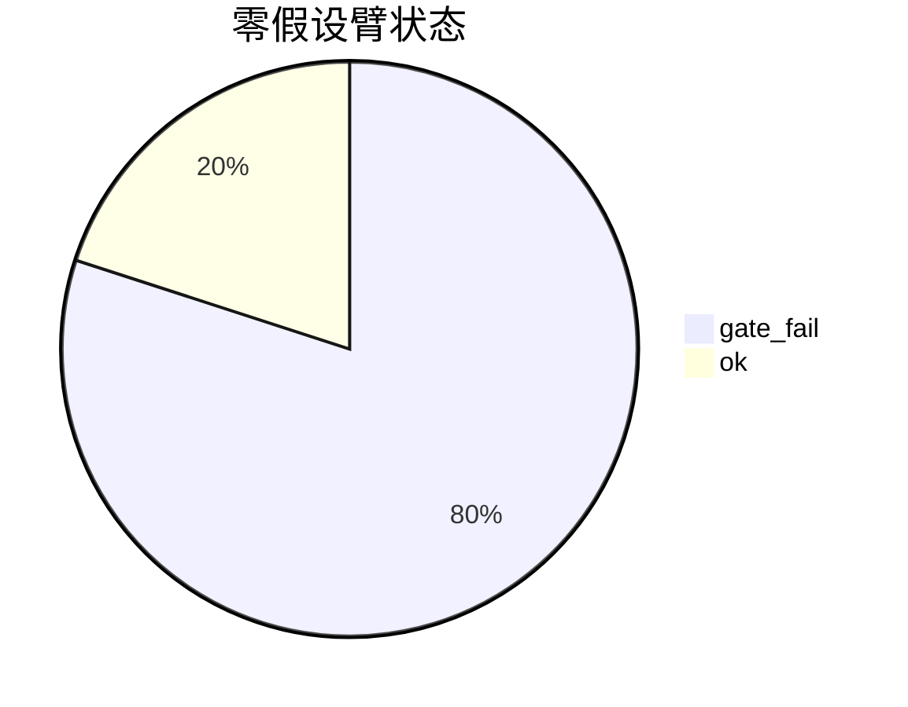
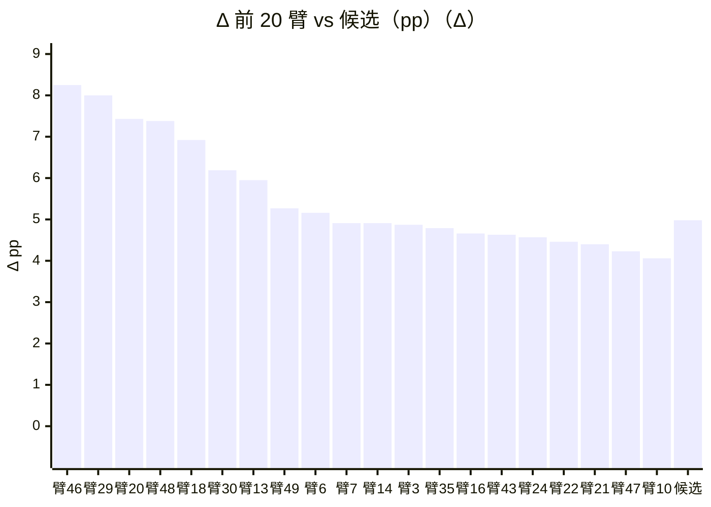

<!-- report-of:results/R36/r36_v2_preB2_arms.json -->
# R36 冻结配置读数 · 结果报告（`r36_v2_preB2_arms`）

> 由入库摘要机械渲染（`result_report`），数字只来自产物，勿手改；判决以单元结论段为准。 选中集 = 每日按分数取前 20（不过组合并发）；分布画像为描述性副读数，**判决只看 Δ、过门率、判定线**，rdd 门不过的臂不因分布好看而回池。

**机械判决：no_batch**

## 主读数

| 字段 | 值 |
|---|---|
| `candidate.delta_median` | +4.98pp |
| `candidate.delta_portfolio_median` | +12.01pp |
| `candidate.gate_rate` | 100.0% |
| `candidate.n_selected_median` | 8894 |
| `candidate.n_taken_median` | 297.5 |
| `window` | {"end": "2026-09-04", "start": "2022-01-01"} |
| `line` | — |

## 候选 / 等权 / 零假设臂：分布画像

零假设臂（按 Δ 降序；候选 Δ 中位 = +4.98pp；Δ = 臂选中集 margin − 等权中位）：

| 臂 | 状态 | Δ | 笔数 | 胜率 | 盈亏比 | 均盈 | 均亏 | p5 | 中位 | p95 | ≥3×均亏占比 | 前5%赢单毛利占比 | 收益回撤比 |
|---|---:|---:|---:|---:|---:|---:|---:|---:|---:|---:|---:|---:|---:|
| 臂 46 | ok | +8.25pp | — | — | — | — | — | — | — | — | — | — | — |
| 臂 29 | gate_fail | +8.00pp | — | — | — | — | — | — | — | — | — | — | — |
| 臂 20 | ok | +7.43pp | — | — | — | — | — | — | — | — | — | — | — |
| 臂 48 | gate_fail | +7.38pp | — | — | — | — | — | — | — | — | — | — | — |
| 臂 18 | gate_fail | +6.92pp | — | — | — | — | — | — | — | — | — | — | — |
| 臂 30 | gate_fail | +6.19pp | — | — | — | — | — | — | — | — | — | — | — |
| 臂 13 | gate_fail | +5.95pp | — | — | — | — | — | — | — | — | — | — | — |
| 臂 49 | ok | +5.27pp | — | — | — | — | — | — | — | — | — | — | — |
| 臂 6 | gate_fail | +5.16pp | — | — | — | — | — | — | — | — | — | — | — |
| 臂 7 | gate_fail | +4.91pp | — | — | — | — | — | — | — | — | — | — | — |
| 臂 14 | gate_fail | +4.91pp | — | — | — | — | — | — | — | — | — | — | — |
| 臂 3 | gate_fail | +4.87pp | — | — | — | — | — | — | — | — | — | — | — |
| 臂 35 | gate_fail | +4.79pp | — | — | — | — | — | — | — | — | — | — | — |
| 臂 16 | ok | +4.66pp | — | — | — | — | — | — | — | — | — | — | — |
| 臂 43 | gate_fail | +4.63pp | — | — | — | — | — | — | — | — | — | — | — |
| 臂 24 | gate_fail | +4.57pp | — | — | — | — | — | — | — | — | — | — | — |
| 臂 22 | gate_fail | +4.46pp | — | — | — | — | — | — | — | — | — | — | — |
| 臂 21 | ok | +4.40pp | — | — | — | — | — | — | — | — | — | — | — |
| 臂 47 | gate_fail | +4.23pp | — | — | — | — | — | — | — | — | — | — | — |
| 臂 10 | gate_fail | +4.06pp | — | — | — | — | — | — | — | — | — | — | — |
| 臂 37 | ok | +3.56pp | — | — | — | — | — | — | — | — | — | — | — |
| 臂 12 | gate_fail | +3.55pp | — | — | — | — | — | — | — | — | — | — | — |
| 臂 9 | gate_fail | +3.41pp | — | — | — | — | — | — | — | — | — | — | — |
| 臂 33 | gate_fail | +3.31pp | — | — | — | — | — | — | — | — | — | — | — |
| 臂 28 | gate_fail | +3.16pp | — | — | — | — | — | — | — | — | — | — | — |
| 臂 38 | gate_fail | +3.08pp | — | — | — | — | — | — | — | — | — | — | — |
| 臂 45 | gate_fail | +2.99pp | — | — | — | — | — | — | — | — | — | — | — |
| 臂 26 | gate_fail | +2.98pp | — | — | — | — | — | — | — | — | — | — | — |
| 臂 15 | ok | +2.85pp | — | — | — | — | — | — | — | — | — | — | — |
| 臂 5 | gate_fail | +2.49pp | — | — | — | — | — | — | — | — | — | — | — |
| 臂 17 | ok | +2.49pp | — | — | — | — | — | — | — | — | — | — | — |
| 臂 42 | gate_fail | +2.42pp | — | — | — | — | — | — | — | — | — | — | — |
| 臂 27 | gate_fail | +2.40pp | — | — | — | — | — | — | — | — | — | — | — |
| 臂 25 | ok | +2.13pp | — | — | — | — | — | — | — | — | — | — | — |
| 臂 8 | gate_fail | +1.96pp | — | — | — | — | — | — | — | — | — | — | — |
| 臂 36 | gate_fail | +1.90pp | — | — | — | — | — | — | — | — | — | — | — |
| 臂 32 | gate_fail | +1.84pp | — | — | — | — | — | — | — | — | — | — | — |
| 臂 0 | gate_fail | +1.63pp | — | — | — | — | — | — | — | — | — | — | — |
| 臂 19 | gate_fail | +1.48pp | — | — | — | — | — | — | — | — | — | — | — |
| 臂 31 | gate_fail | +1.42pp | — | — | — | — | — | — | — | — | — | — | — |
| 臂 44 | gate_fail | +1.41pp | — | — | — | — | — | — | — | — | — | — | — |
| 臂 2 | gate_fail | +1.37pp | — | — | — | — | — | — | — | — | — | — | — |
| 臂 41 | ok | +1.32pp | — | — | — | — | — | — | — | — | — | — | — |
| 臂 39 | gate_fail | +1.27pp | — | — | — | — | — | — | — | — | — | — | — |
| 臂 23 | gate_fail | +0.84pp | — | — | — | — | — | — | — | — | — | — | — |
| 臂 4 | gate_fail | +0.83pp | — | — | — | — | — | — | — | — | — | — | — |
| 臂 1 | gate_fail | +0.83pp | — | — | — | — | — | — | — | — | — | — | — |
| 臂 40 | gate_fail | +0.54pp | — | — | — | — | — | — | — | — | — | — | — |
| 臂 11 | gate_fail | +0.39pp | — | — | — | — | — | — | — | — | — | — | — |
| 臂 34 | gate_fail | -0.68pp | — | — | — | — | — | — | — | — | — | — | — |

