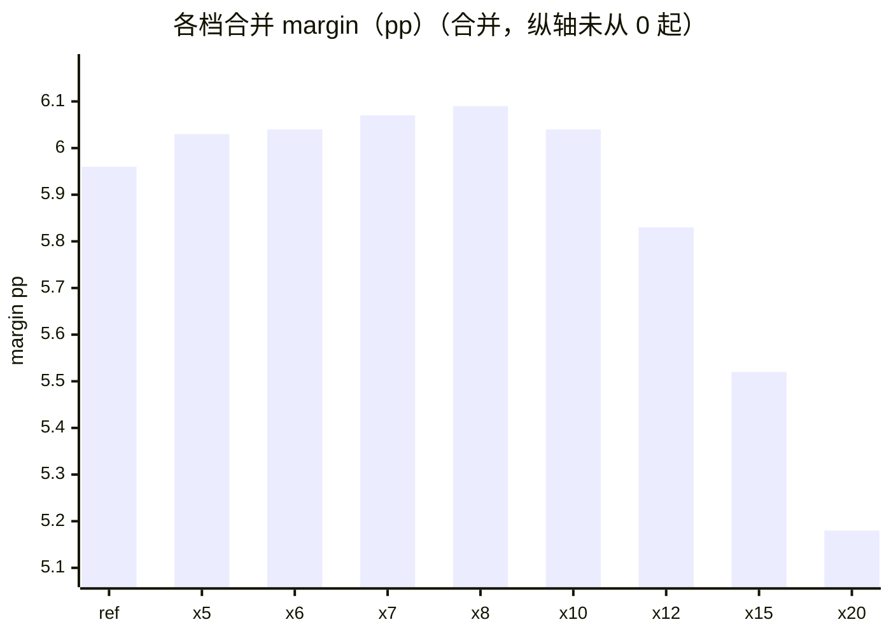

<!-- report-of:results/R44/r44_scan.json -->
# R44 J 日低点止损宽度 · 结果报告（`r44_scan`）

> 由入库摘要机械渲染（`result_report`），数字只来自产物，勿手改；判决以单元结论段为准。 margin = 胜率 − 盈亏平衡胜率；ref = 现行 pct10；合并 = 挖掘 A∪B。

**机械判决：❌ falsified**

| 判据 | 结果 | 规则 |
|---|---|---|
| C1 | ✓ | 两段挖掘窗各自参照档 n_taken ≥ 100（不过=untested） |
| C2 | ✗ | x*=两窗合并 margin 最高且过 rdd 门的档；x* 两窗各自 Δmargin>0 且过门 |
| C3 | ✗ | ①x* 相邻两档（端点取单侧）两窗 Δmargin 均>0；②两窗各自最优档与 x* 相差 ≤1 档；任一不过 ⇒ C3 False（结局最高 provisio |
| C4 | confirmed_fail | — |

## 各档（两段合并）

| 档位 | margin | 胜率 | 盈亏比 | 过 rdd 门 | 止损占比 | 组合成交 |
|---|---:|---:|---:|---:|---:|---:|
| ref | +5.96pp | — | — | ✓ | 17.1% | 1,131 |
| x5 | +6.03pp | — | — | ✓ | 29.2% | 1,181 |
| x6 | +6.04pp | — | — | ✓ | 25.2% | 1,178 |
| x7 | +6.07pp | — | — | ✓ | 21.8% | 1,151 |
| x8 | +6.09pp | — | — | ✗ | 19.0% | 1,132 |
| x10 | +6.04pp | — | — | ✓ | 14.8% | 1,105 |
| x12 | +5.83pp | — | — | ✗ | 11.6% | 1,089 |
| x15 | +5.52pp | — | — | ✓ | 8.3% | 1,044 |
| x20 | +5.18pp | — | — | ✓ | 5.0% | 1,018 |

## 各档合并 margin（pp）

